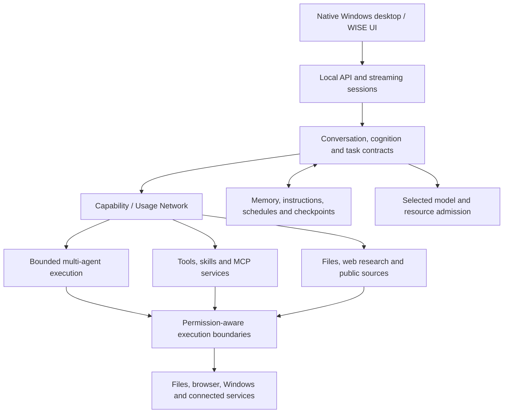

<div align="center">


# WISE Agent

### One workspace. A coordinated system of capabilities.

A **Windows-first, local-first Agent OS** connecting conversation, cognition, multi-agent execution, research, durable state and desktop automation.

[](https://github.com/qwzx4893-stack/WISE-Agent/actions/workflows/validate.yml)
[](https://github.com/qwzx4893-stack/WISE-Agent/actions/workflows/security-regressions.yml)
[](docs/VALIDATION.md)

[](docs/INSTALLATION.md)
[](docs/INSTALLATION.md)
[](Supergent--main/docs/MCP_CONNECTION_MARKETPLACE.md)
[](THIRD_PARTY_NOTICES.md)

**[Get started](#get-started)** · **[Architecture](#how-the-system-fits-together)** · **[Documentation](#documentation)** · **[العربية](docs/README.ar.md)**

</div>

---

> [!IMPORTANT]
> **Development preview — not a certified production release.** WISE has substantial implemented capabilities and source-level regression evidence, but unconditional daily-use reliability is not established. Native Windows acceptance, dependency remediation, complete data-egress policy and real-account flows remain open. [See the validation boundaries](docs/VALIDATION.md).

## Contents

- [Why WISE](#why-wise)
- [Capabilities](#capabilities)
- [Architecture](#how-the-system-fits-together)
- [Get started](#get-started)
- [Models and services](#connect-models-and-services)
- [Optional runtimes](#optional-runtimes)
- [Permissions and trust](#permissions-and-trust)
- [Validation and quality](#validation-and-quality)
- [Repository map](#repository-map)
- [Documentation](#documentation)
- [Roadmap](#roadmap)
- [Contribute and get help](#contribute-and-get-help)
- [Licensing and acknowledgements](#licensing-and-acknowledgements)

## Why WISE

WISE is not just a chat UI with a collection of tool buttons. Its Agent OS core connects **understanding a request, discovering the right capabilities, coordinating execution, preserving state and checking the outcome** in one desktop workspace.

| Principle | What it means in WISE |
| --- | --- |
| **Discover what the task needs** | The Capability / Usage Network routes toward relevant tools, grouped skills, MCP services and research sources instead of placing the entire inventory into every prompt. |
| **Keep work connected** | Conversations, instructions, artifacts, task contracts and checkpoints provide continuity across execution and recovery paths. |
| **Keep important choices explicit** | Users select their model, enable optional runtimes and authorize sensitive access. A catalog entry is not a connected service; a passing test is not proof of universal safety. |

**Local-first does not mean offline-only.** The workspace and state can run locally, while selected model providers, search services and integrations may send data to external services. Those choices require configuration and appropriate permissions.

## Capabilities

### Understand, coordinate, execute

| Area | Included implementation | Important boundary |
| --- | --- | --- |
| **Conversation and cognition** | Streaming turns, intent/task routing, planning, execution contracts, outcome checks and persistent user instructions. | Model accuracy and task completion still require task-level evaluation. |
| **Multi-agent execution** | Specialized workers, capability teams, single-writer coordination and bounded execution paths. | Effective delegation depends on the task, model and configured capabilities. |
| **Capability discovery** | Task-oriented tool selection, grouped skill discovery, MCP routing and source guidance. | Availability, permission, installation and successful execution are separate states. |
| **Models and efficiency** | Explicit cloud/local model selection, context/request optimizations, caching and worker/resource admission. | No promise of identical answers or a fixed token-saving percentage. |

### Work with files, knowledge and the desktop

| Area | Included implementation | Important boundary |
| --- | --- | --- |
| **Files and research** | File inspection/editing, document handling, web research, source retrieval and evidence-oriented checks. | Search freshness, source quality and factual completeness remain acceptance concerns. |
| **State and recovery** | Durable sessions, artifacts, checkpoints, schedules and diagnostic records. | Not universal rollback of arbitrary filesystem or system changes. |
| **Windows and browser** | Native desktop host, file/command operations, browser workflows and opt-in background/system integration. | Trusted user-level execution is powerful, but it is not an OS sandbox. |
| **MCP and messaging** | MCP Market, remote/local server configuration, per-server authorization and messaging connectors. | External services have their own credentials, policies and compatibility requirements. |
| **Voice** | Optional isolated synthesis/transcription, interruption handling and VRAM admission guards. | Weights, permitted reference assets and hardware acceptance are separate provisioning steps. |
| **Security and OSINT** | Public-source adapters and on-demand recipes for optional independent security tools. | Use only with authorization. Large platforms and uninstalled tools are not silently deployed. |

<details>
<summary><strong>Example workflows the architecture is intended to support</strong></summary>

- Research a topic, inspect sources, import relevant documents and produce a cited report.
- Inspect a coding workspace, plan an edit, modify files and run outcome checks.
- Continue a long-running task using its conversation, artifacts and persisted state.
- Connect an authorized MCP service and expose relevant capabilities to the agent.
- Schedule a bounded task or use explicitly enabled desktop/browser operations.

These describe workflows, **not a claim that every combination has passed live end-to-end acceptance**. Start with a dedicated workspace and low-risk data.

</details>

## How the system fits together



The primary runtime lives in [`Supergent--main/`](Supergent--main/README.md). The root supervisor can additionally coordinate retained **Leon** services, which have separate dependencies and profile secrets. The native desktop path does not require starting every optional service.

See the [architecture guide](docs/ARCHITECTURE.md) for module ownership, entry points and runtime boundaries.

## Get started

### 1. Prepare the prerequisites

| Requirement | Purpose |
| --- | --- |
| **Windows 10 or 11** | Primary desktop target. Linux CI checks source behavior; it is not Linux desktop certification. |
| **Python 3.11** | Supported project runtime for the documented installation. |
| **Git** | Clone the public source workspace. |
| **Microsoft WebView2 Runtime** | Render the native window. This does **not** open WISE in the Edge browser. |
| **Brave, for installed-browser automation** | The installed-Brave path needs a local Brave installation. |

### 2. Install the text-first runtime

```powershell
git clone https://github.com/qwzx4893-stack/WISE-Agent.git
cd WISE-Agent
powershell -NoProfile -File tools/Install-WISE.ps1
```

The installer expects `python` to be **Python 3.11**. If necessary, pass the correct interpreter path:

```powershell
powershell -NoProfile -File tools/Install-WISE.ps1 -Python "C:\Path\To\Python311\python.exe"
```

### 3. Open the native app

```powershell
.\Supergent--main\.venv\Scripts\python.exe .\Supergent--main\wise_desktop.py --native-only
```

### 4. Configure your first conversation

1. Open **Settings → Models and providers** and configure your own provider or supported local runtime.
2. Choose a model from the composer. Provider failures do not silently switch to another provider.
3. Start with a small task in a dedicated workspace; review requested permissions.

No provider credentials, account sessions, model weights or private voice assets are bundled. The base installation does not silently provision optional services. See the [complete installation guide](docs/INSTALLATION.md).

<details>
<summary><strong>Backend-only development</strong></summary>

From the repository root, after installation:

```powershell
cd Supergent--main
.\.venv\Scripts\python.exe -m uvicorn api.server:app --host 127.0.0.1 --port 8765
```

Keep this API loopback-only unless authentication and trusted-origin controls are deliberately configured. This starts the backend, not the native acceptance workflow.

</details>

## Connect models and services

**Models.** Select the cloud or local model you intend to use. Keep credentials local and separate from source control. Resource admission and lifecycle management help coordinate workloads; actual capacity depends on your hardware.

**MCP Market.** Browse server information, configure a supported remote endpoint or trusted local command, then use the server's supported authorization method. Some servers provide browser OAuth; others require an API key or an installed application. Universal one-click login cannot be promised for every third-party service.

**Messaging.** Configure only the channels you intend to use. External messages are real actions, not test fixtures. Authentication, recipient scope and account isolation require explicit configuration and acceptance.

No Nango account or broker key is required by the current direct-MCP path. See [connection setup](Supergent--main/docs/PLUGINS.md) and [MCP Market behavior](Supergent--main/docs/MCP_CONNECTION_MARKETPLACE.md).

## Optional runtimes

Provision extras only when needed:

| Component | Setup reference |
| --- | --- |
| **Leon services and SDKs** | [Workspace integration](docs/INSTALLATION.md#leon-workspace-integration); separate Node.js/pnpm prerequisites. |
| **Semantic discovery / advanced compression** | [Dependency matrix](docs/INSTALLATION.md#dependency-matrix); optional requirements and downloads. |
| **Voice synthesis and transcription** | [Voice installation](docs/INSTALLATION.md#voice) and [GPU/runtime policy](Supergent--main/docs/VOICE_RUNTIME.md). |
| **Security / public-source intelligence** | [Optional security tooling](Supergent--main/docs/OPTIONAL_SECURITY_TOOLS.md); isolated recipes, not bulk installation. |
| **MCP and messaging accounts** | [Direct connection guide](Supergent--main/docs/PLUGINS.md); per-service transport, credentials and consent. |

> [!NOTE]
> **Source is not a bundled appliance.** This repository includes manifests, setup recipes, lockfiles where available and integration code—not generated environments, all upstream binaries, weights or account access. Runtime requirements still include version ranges; installation is not yet a fully reproducible cross-platform lock.

## Permissions and trust

WISE can edit files, run commands, interact with browsers and connect to external services. Treat enabled capabilities as real access to your machine and data.

- **Official elevation only.** Administrative operations use Windows UAC and a fixed broker catalog. No bypass or invisible unrestricted administrator access.
- **Explicit device access.** Browser profiles, local applications, background operation and system integration are not interchangeable with an isolated task workspace.
- **Untrusted inputs stay untrusted.** Pages, files, skills and MCP results are not human authorization. Model instructions are not access controls.
- **Private state stays out of publication.** Credentials, browser storage, sessions, recordings, weights and training data are excluded from public source.
- **Documented limits.** Worker isolation is not OS sandboxing, and complete private-data egress policy remains an open release gate.

Read the [security policy](SECURITY.md), [distribution contract](docs/DISTRIBUTION.md) and [validation limits](docs/VALIDATION.md) before unattended or sensitive use.

## Validation and quality

The badges above show **actual workflow status**, not a security certificate or coverage percentage. Source regressions, renderer scenarios, model behavior, external accounts and native Windows execution are different evidence layers.

### Verified source snapshot · 15 October 2026

These results belong to executable-source commit [`71a4217`](https://github.com/qwzx4893-stack/WISE-Agent/commit/71a4217ef07bca63b14525e24417d8d2c86ee177). Later documentation-only updates do not turn them into new whole-product acceptance.

| Evidence | Result | Scope |
| --- | --- | --- |
| Local offline security contracts | **591 passed**, 0 failed, 0 skipped | 24 suites in the audit checkout; synthetic/component contracts. |
| [GitHub focused security](https://github.com/qwzx4893-stack/WISE-Agent/actions/runs/38780577374) · Windows / Linux | **584 / 581 passed**, no failures or skips | Optional vendor/platform omissions are explicitly recorded. |
| [GitHub source regression](https://github.com/qwzx4893-stack/WISE-Agent/actions/runs/38780577135) · Windows | **2,148 passed**, 14 skipped, 11 deselected | Non-interactive source tests; not native certification. |
| Same source regression · Linux | **2,144 passed**, 15 skipped, 14 deselected | Source compatibility; not a native Linux release. |

These suites overlap; their counts **must not be added together**. Skipped, deselected, mocked and unavailable cases are not live successes.

<details>
<summary><strong>Run the CI-aligned checks locally</strong></summary>

Use an isolated project environment with the test dependencies listed in the workflows:

```powershell
cd Supergent--main
.\.venv\Scripts\python.exe -m qa.acceptance.source_regression
.\.venv\Scripts\python.exe -m qa.acceptance.security_regression --output qa-results/security-local --timeout 900
```

Review [source CI](.github/workflows/validate.yml) and [focused security CI](.github/workflows/security-regressions.yml) for their dependency sets. Optional vendor/native tests need separate environments. Never supply real accounts or paid-model credentials to synthetic fixtures.

</details>

See [Validation](docs/VALIDATION.md) and the [acceptance plan](Supergent--main/docs/WISE_FINAL_VALIDATION_PLAN.md) for release blockers.

## Repository map

```text
WISE-Agent/
├── Supergent--main/           Primary Agent OS runtime
│   ├── agent_core.py          Conversation and execution entry point
│   ├── api/                   Local API, streaming and integration routes
│   ├── core/                  Cognition, routing, state, models and permissions
│   ├── ui/wise_web/           Current WISE desktop renderer
│   ├── skills/                Agent-facing skill inventory
│   ├── tools/                 Capability packs and optional runtime setup
│   ├── tests/                 Component and regression tests
│   └── qa/                    Acceptance and evidence tooling
├── leon-develop/              Retained Leon integration, SDKs and lockfiles
├── config/                    Cross-service configuration code
├── wise_desktop.py            Workspace desktop entry point
├── wise_supervisor.py         Optional multi-service process supervisor
├── tools/                    Installation and publication utilities
├── tests/                    Cross-service integration tests
├── docs/                     Workspace guides and repository assets
└── .github/                  CI, issue forms and contribution templates
```

The current UI is `Supergent--main/ui/wise_web`; no comparison interface is required. Older flattened clones should use these paths.

## Documentation

| Start here | Go deeper |
| --- | --- |
| [Installation and dependencies](docs/INSTALLATION.md) | [Agent OS core overview](Supergent--main/README.md) |
| [Architecture and source map](docs/ARCHITECTURE.md) | [MCP Market and authentication](Supergent--main/docs/MCP_CONNECTION_MARKETPLACE.md) |
| [Validation and known limits](docs/VALIDATION.md) | [Voice runtime and resource policy](Supergent--main/docs/VOICE_RUNTIME.md) |
| [Troubleshooting and FAQ](docs/FAQ.md) | [Optional security / OSINT tooling](Supergent--main/docs/OPTIONAL_SECURITY_TOOLS.md) |
| [Contribution guide](CONTRIBUTING.md) | [Distribution and publication](docs/DISTRIBUTION.md) |
| [دليل WISE بالعربية](docs/README.ar.md) | [Licensing and provenance](THIRD_PARTY_NOTICES.md) |

## Roadmap

The next milestone is **evidence-backed daily-use reliability**, not simply a larger catalog. There is no promised release date.

- [ ] Complete isolated interactive Windows acceptance: UAC, native frame/input, clean install, update, rollback and uninstall.
- [ ] Close dependency/advisory and provenance findings with compatibility-tested remediation.
- [ ] Complete destination/data/scope egress controls and end-to-end owner-approval/resume paths.
- [ ] Validate live connector authorization, refresh, revocation and account isolation.
- [ ] Strengthen research correctness and recovery from tool/model failures.
- [ ] Validate voice clarity, interruption behavior and resource coexistence on target hardware.
- [ ] Complete two/eight-hour native soak and decide WISE-specific licensing before stable distribution.

See [acceptance gates](docs/VALIDATION.md#open-acceptance-gates). A documentation refresh does not close them.

## Contribute and get help

Contributions should preserve the coordinated Agent OS architecture, make behavior testable and keep permission boundaries explicit.

- **Found a bug?** [Open a structured report](https://github.com/qwzx4893-stack/WISE-Agent/issues/new?template=bug.yml) with redacted reproduction steps.
- **Have an improvement?** [Propose it](https://github.com/qwzx4893-stack/WISE-Agent/issues/new?template=feature.yml), then follow the [contribution guide](CONTRIBUTING.md).
- **Need setup help?** Start with the [FAQ](docs/FAQ.md) and [support guide](.github/SUPPORT.md).
- **Found a security issue?** Follow [private disclosure guidance](SECURITY.md), not a public issue.
- **Joining a review?** Read the [community conduct guidelines](.github/CODE_OF_CONDUCT.md).

## Licensing and acknowledgements

WISE combines original work and retained third-party components. **There is currently no repository-wide license grant for WISE-specific source.** Public visibility is not permission to reuse it; the historical root package MIT field does not license the entire workspace.

Third-party projects retain their own licenses and notices. See [attribution](THIRD_PARTY_NOTICES.md), [licensing status](Supergent--main/docs/releases/LICENSING_STATUS.md) and [`PUBLICATION_MANIFEST.json`](PUBLICATION_MANIFEST.json). Restricted assets, private recordings and custom voice weights are not published.

Thanks to the upstream communities behind the retained Leon integration, MCP ecosystem, native hosting, model runtimes and testing tools. Inclusion does not imply endorsement or affiliation.

---

<div align="center">

**WISE Agent OS** · Local workspace. Connected capabilities. Explicit boundaries.

[Documentation](docs/INSTALLATION.md) · [Issues](https://github.com/qwzx4893-stack/WISE-Agent/issues) · [Security](SECURITY.md) · [Back to top](#wise-agent)

</div>
