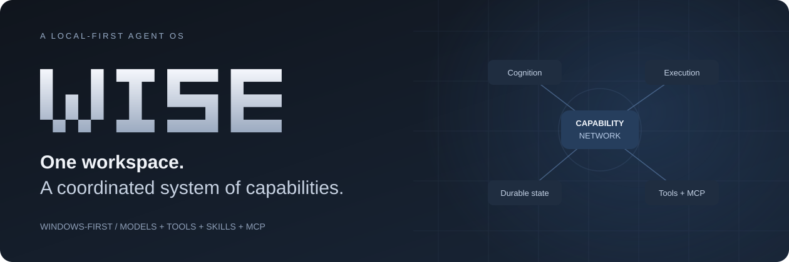

<div align="center">



# WISE Agent — دليل عربي

**منظومة Agent OS موجهة لويندوز: محادثة، تفكير وتخطيط، تنسيق وكلاء، أدوات ومهارات وMCP، بحث وحالة مستمرة وتحكم مكتبي.**

[English README](../README.md) · [التثبيت](INSTALLATION.md) · [المعمارية](ARCHITECTURE.md) · [حدود الجاهزية](VALIDATION.md)

</div>

> [!IMPORTANT]
> المشروع **نسخة تطويرية**، وليس إصدارًا معتمدًا للاستخدام غير المراقب. نجاح اختبارات المصدر لا يثبت سلامة كل وظائف ويندوز أو الحسابات الخارجية أو الصوت. ما زالت هناك بوابات قبول مفتوحة، موثقة بوضوح.

## ما الذي يميز WISE؟

WISE ليس مجرد واجهة دردشة. يربط فهم الطلب بعقد المهمة، واكتشاف القدرات المناسبة، وتنفيذ العمل والتحقق منه وحفظ سياقه.

| الطبقة | دورها |
| --- | --- |
| التفكير وتنسيق التنفيذ | توجيه الطلبات والتخطيط وفرق الوكلاء ومسارات تنفيذ محدودة. |
| شبكة الاستخدام والقدرات | اكتشاف الأدوات والمهارات وخدمات MCP والمصادر ذات الصلة، بدل تحميل المخزون كله في كل طلب. |
| النماذج والموارد | اختيار المستخدم للنموذج، تحسين السياق والطلبات، وإدارة العمال وحدود الموارد. |
| الاستمرارية | جلسات وتعليمات مستخدم وذاكرة ومخرجات ونقاط استعادة ومهام مجدولة. |
| الجهاز والخدمات | عمليات ملفات ومتصفح وويندوز وتكاملات خارجية، حسب الإعداد والصلاحية. |
| الصوت الاختياري | توليد وتفريغ صوتي منفصلان، مع إدارة موارد؛ النماذج والأصول الخاصة لا تُرفق بالمستودع. |

وجود قدرة في الكتالوج لا يعني أنها مثبتة أو متصلة أو مجرّبة فعليًا. والاستعادة ليست تراجعًا شاملًا عن أي تغيير في الجهاز.

## البداية

تحتاج Windows 10/11 وPython 3.11 وGit وWebView2. ولتشغيل مسار المتصفح المثبت تحتاج Brave. WebView2 محرك عرض النافذة، وليس فتح الواجهة في متصفح Edge.

```powershell
git clone https://github.com/qwzx4893-stack/WISE-Agent.git
cd WISE-Agent
powershell -NoProfile -File tools/Install-WISE.ps1
.\Supergent--main\.venv\Scripts\python.exe .\Supergent--main\wise_desktop.py --native-only
```

إذا كان أمر `python` يشير إلى إصدار آخر، مرّر مسار Python 3.11 بواسطة `-Python` كما يوضح [دليل التثبيت](INSTALLATION.md).

بعد الفتح، أعدّ مزودك من الإعدادات، واختر النموذج من مستطيل الكتابة، وابدأ بمهمة صغيرة داخل مجلد عمل مخصص. لا توجد مفاتيح أو جلسات حسابات أو أوزان نماذج مرفقة.

## التكاملات والصوت

- **MCP:** بعض الخوادم تدعم تسجيل الدخول بالمتصفح، وأخرى تحتاج مفتاح خدمة أو برنامجًا محليًا. مسار الاتصال المباشر الحالي لا يحتاج Nango.
- **المراسلة:** الإرسال إجراء حقيقي إلى مستلم حقيقي؛ إعداد الحساب وصلاحياته والتحقق منه منفصلة عن ظهور التطبيق في القائمة.
- **الصوت:** يحتاج بيئة وأوزانًا وأصولًا مسموحًا باستخدامها، وتحققًا عمليًا على الجهاز. لا توجد وعود بجودة أو استهلاك ثابتين على كل الأجهزة.
- **Leon والأدوات الثقيلة:** تكاملات اختيارية، لا يلزم تشغيلها كلها لبدء محادثة نصية.

## الأمان والاختبارات

العمليات الإدارية تستخدم UAC الرسمي فقط. لا يوجد تجاوز UAC، ولا تعتبر تعليمات النموذج أو تشغيل أداة بصلاحيات المستخدم عزلًا أمنيًا. «محلي أولًا» لا يعني أن كل البيانات تبقى محلية؛ خدمات النماذج والبحث وMCP والمراسلة قد ترسل بيانات للخارج.

لقطة المصدر [`71a4217`](https://github.com/qwzx4893-stack/WISE-Agent/commit/71a4217ef07bca63b14525e24417d8d2c86ee177) لها نتائج اختبارات مصدر وأمان موثقة في [README الإنجليزي](../README.md#validation-and-quality). الأعداد متداخلة، ولا تُجمع كاختبار شامل واحد. اختبارات ويندوز التفاعلية المعزولة والحسابات الحقيقية والتشغيل الطويل ما زالت غير مكتملة.

## روابط مفيدة

- [دليل التثبيت والتبعيات](INSTALLATION.md)
- [شرح المعمارية](ARCHITECTURE.md)
- [الأسئلة الشائعة](FAQ.md)
- [حالة التحقق وما لم يُختبر](VALIDATION.md)
- [المساهمة](../CONTRIBUTING.md) و[الدعم](../.github/SUPPORT.md)
- [الإبلاغ الأمني الخاص](../SECURITY.md)
- [الإسناد والتراخيص](../THIRD_PARTY_NOTICES.md)

**الترخيص:** إتاحة المستودع للعامة ليست إذنًا بإعادة استخدام كل محتوياته. لا توجد حاليًا رخصة شاملة لكود WISE الخاص؛ المكونات الخارجية تحتفظ بشروطها المستقلة.
